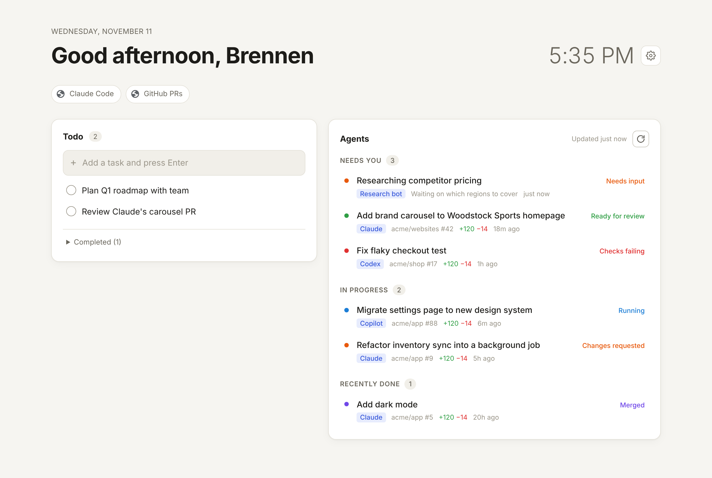

# Helm: todos and agents on your new tab

A Chrome extension that replaces the new tab page with two things:

1. **A todo list.** Add, complete, edit, reorder. It saves instantly and stays in sync across open tabs.
2. **An agent dashboard.** A live view of what your coding agents (Claude Code, Copilot, Codex, Cursor, Devin, Jules, or any bot) are doing on GitHub, grouped as **Needs you**, **In progress** and **Recently done**.



## Install (unpacked)

1. Open `chrome://extensions` and turn on **Developer mode** (top right).
2. Click **Load unpacked** and select this `helm-newtab` folder.
3. Open a new tab. Chrome may ask whether to keep the new tab change; choose **Keep it**.
4. Click the gear icon, paste a GitHub token, and save.

No build step. It's plain HTML, CSS and JS (Manifest V3).

## GitHub token

Create a [classic token](https://github.com/settings/tokens/new?scopes=repo&description=Helm%20new%20tab) with the `repo` scope (`public_repo` is enough if you only care about public repos). Fine-grained tokens can work, but they sometimes can't see check status.

The token is stored in `chrome.storage.local` on your machine and is sent only to `api.github.com`.

## How agent work is detected

Every few minutes (5 by default), the background worker runs one GraphQL search: `is:pr involves:@me updated:>=<lookback>`. A PR counts as **agent work** when its author login or head branch contains one of your agent patterns. The defaults are:

```
claude, ccr-, copilot, codex, cursor, devin, jules, [bot]
```

So `claude/fix-nav`, `codex/flaky-test`, PRs authored by `Copilot`, and Claude Code cloud branches (`ccr-…`) are all picked up. Turn off **Only show agent PRs** in Settings to see every PR you're involved in.

| Status | When | Group |
|---|---|---|
| Ready for review | Open, not draft, checks green | Needs you |
| Checks failing | CI failed | Needs you |
| Approved | Approved and green: ready to merge | Needs you |
| Running | Checks pending, or a draft still being pushed to | In progress |
| Drafting | Draft PR, idle | In progress |
| Changes requested | You sent it back to the agent | In progress |
| Merged / Closed | Within the lookback window | Recently done |

The toolbar icon badge shows the **Needs you** count. When notifications are on, you get a desktop notification when something moves into *Needs you* or merges. Clicking the notification opens the PR.

## Custom agent feed (optional)

For agents that don't live on GitHub (local scripts, research bots, cron jobs), point Helm at any URL that returns JSON:

```json
[
  { "id": "r1", "title": "Research competitor pricing", "agent": "Research bot",
    "status": "needs_input", "detail": "Which regions?", "url": "https://…" }
]
```

`status` can be `running`, `needs_input`/`blocked`, `review`, `failing`, `done`, or any of the statuses in the table above. `{ "items": [...] }` also works.

To try it locally:

```bash
node examples/feed-server.mjs            # serves examples/agents.json
# Settings → JSON feed URL → http://127.0.0.1:4317/agents.json
```

When you save the URL, Chrome asks for permission to read that host.

## Files

```
manifest.json     MV3 manifest (new tab override, alarms, notifications)
background.js     Polls on an alarm, updates the badge, sends notifications
lib/agents.js     GitHub/feed fetching and status classification (shared)
newtab.html/css/js  The new tab UI: clock, quick links, todos, agents, settings
examples/         Sample feed + tiny local feed server
```

## Ideas for later

- Sync todos across devices (`chrome.storage.sync`, chunked to fit its quotas)
- Turn a todo into an agent task (open Claude Code with the todo as the prompt)
- Linear/Jira issues assigned to agents
